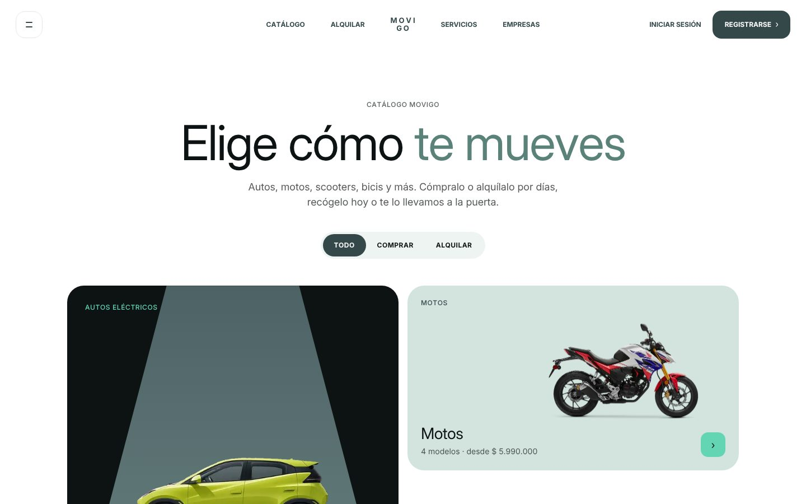
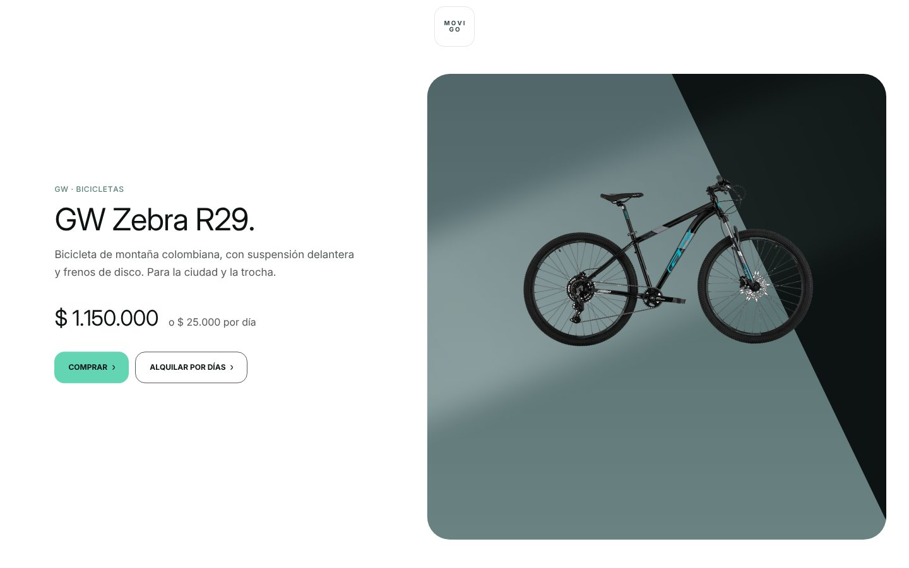
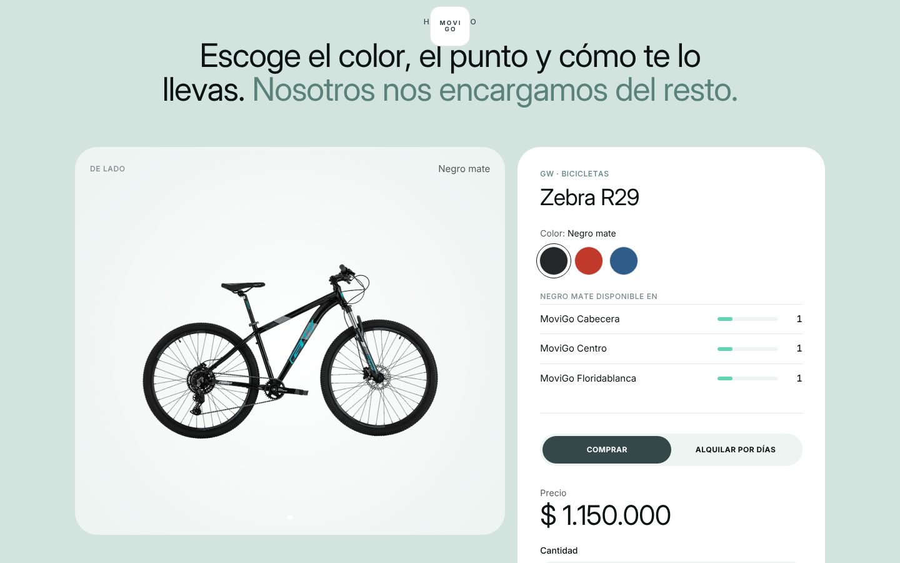
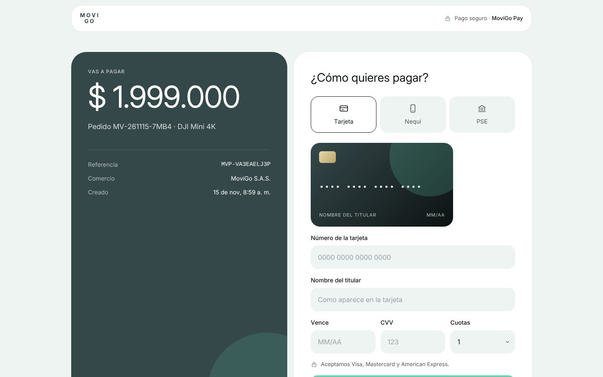
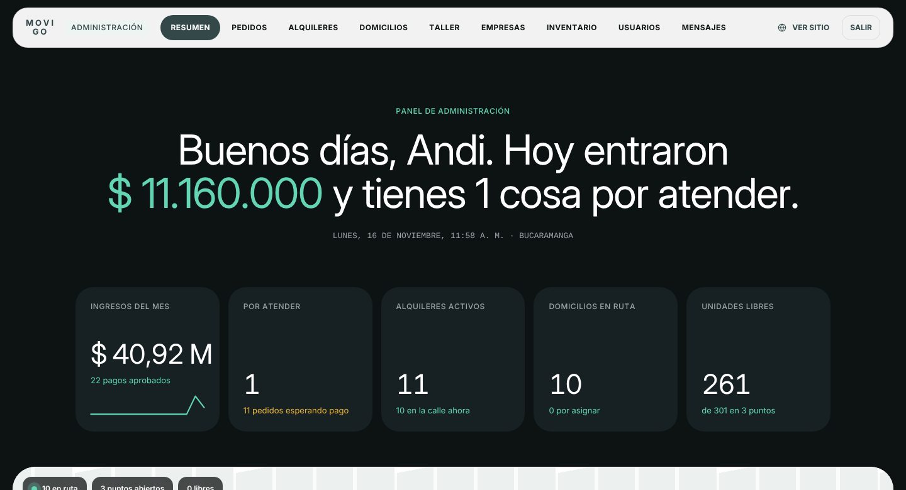
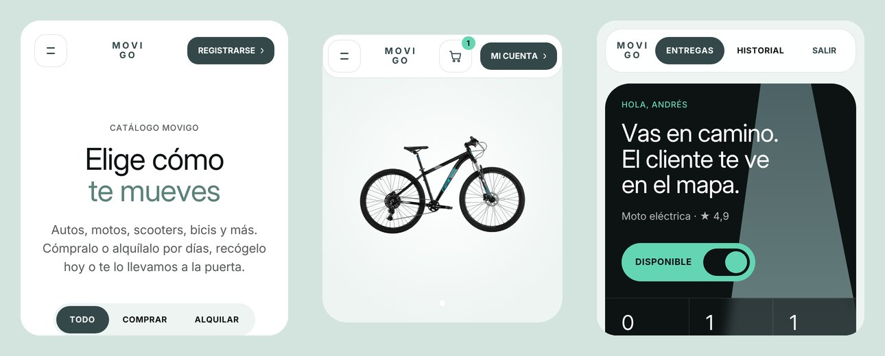
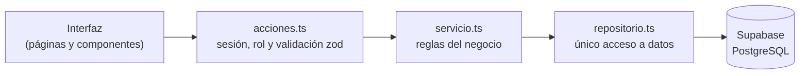

<div align="center">

# MOVIGO

**Compra, alquila o recibe en la puerta tu próximo vehículo.**
Autos eléctricos, motos, scooters, bicicletas, drones, patinetas y accesorios, con domicilios en vivo y taller propio.

[**Ver el sitio →**](https://movi-go-gamma.vercel.app)


</div>

> **Proyecto académico con fines educativos.** Desarrollado para el curso de Ingeniería de Software de la Universidad Autónoma de Bucaramanga (UNAB). Las marcas, modelos y fotos de productos pertenecen a sus respectivos dueños y no hay fines comerciales.

## Contenido

- [Qué es MoviGo](#qué-es-movigo)
- [Capturas](#capturas)
- [Funcionalidades por rol](#funcionalidades-por-rol)
- [Stack](#stack)
- [Arquitectura](#arquitectura)
- [Seguridad](#seguridad)
- [Cómo correrlo](#cómo-correrlo)
- [Base de datos](#base-de-datos)
- [Pagos y datos de prueba](#pagos-y-datos-de-prueba)
- [Domicilios y seguimiento](#domicilios-y-seguimiento)
- [Despliegue](#despliegue)
- [Equipo](#equipo)

## Qué es MoviGo

MoviGo es una plataforma de movilidad urbana en Bucaramanga que junta en un solo lugar:

- **Venta** de vehículos y accesorios, con configurador por color y disponibilidad en cada punto.
- **Alquiler por días**, para probar antes de comprar o usar en un viaje.
- **Domicilios** hechos por la propia flota, con seguimiento en el mapa y código de entrega.
- **Taller** para revisiones y mantenimiento de lo que el cliente compró.
- **Portal empresarial** para que las empresas pidan cotizaciones de flotas.

Tiene tres experiencias: la del **cliente** (con el portal empresarial), la del **domiciliario** (pensada para el celular) y el **panel de administración**.

## Capturas

| Catálogo | Ficha del producto |
|---|---|
|  |  |
| **Configurador por color y punto** | **Pasarela de pago** |
|  |  |

**Panel de administración**



**En el celular:** catálogo, configurador y portal del domiciliario



## Funcionalidades por rol

<details open>
<summary><b>Cliente</b></summary>

| Qué puede hacer | Ruta |
|---|---|
| Catálogo con filtros (categoría, comprar o alquilar) | `/catalogo` |
| Ficha del producto con configurador: color, punto, comprar o alquilar por días | `/producto/<slug>` |
| Carrito y entrega: recoger en un punto o a domicilio | `/carrito` |
| Pago con tarjeta, Nequi o PSE | `/pagar/<referencia>` |
| Inicio de la cuenta: lo que está en curso, seguimiento en vivo e historial | `/mi-cuenta` |
| Pedido con línea de tiempo, mapa y código de entrega | `/mi-cuenta/pedidos/<numero>` |
| Alquiler con código de recogida | `/mi-cuenta/alquileres/<id>` |
| Agendar taller para los vehículos comprados | `/mi-cuenta/mantenimiento` |
| Cobertura, contacto, boletín y documentos legales | `/cobertura`, `/contacto`, `/legal/...` |

</details>

<details>
<summary><b>Empresa (dentro de la cuenta del cliente)</b></summary>

| Qué puede hacer | Ruta |
|---|---|
| Solicitar cotizaciones de flota y aceptarlas | `/empresas` |

</details>

<details>
<summary><b>Domiciliario</b></summary>

| Qué puede hacer | Ruta |
|---|---|
| Conectarse, tomar entregas libres, aceptar o rechazar las asignadas | `/domiciliario` |
| Entrega: ruta en el mapa, Google Maps o Waze, compartir GPS y entregar con el código del cliente (foto opcional) | `/domiciliario/entregas/<id>` |
| Entregas hechas | `/domiciliario/historial` |

</details>

<details>
<summary><b>Administrador</b></summary>

| Qué puede hacer | Ruta |
|---|---|
| Resumen: ingresos, pendientes, flota en vivo, ingresos por día e inventario | `/admin` |
| Pedidos: preparar, entregar o cancelar (con reembolso) | `/admin/pedidos` |
| Alquileres: entregar con el código y recibir la devolución | `/admin/alquileres` |
| Domicilios en vivo: asignar domiciliario y ver la foto de la entrega | `/admin/domicilios` |
| Taller y cotizaciones de empresas | `/admin/mantenimiento`, `/admin/empresas` |
| Inventario: productos, colores, fotos, unidades y traslados | `/admin/inventario` |
| Usuarios y roles (cliente, domiciliario, administrador) | `/admin/usuarios` |
| Mensajes de contacto y suscritos al boletín | `/admin/mensajes` |

El administrador del sistema maneja todo; el administrador de punto mueve las unidades de su punto.

</details>

## Stack

| Capa | Tecnología |
|---|---|
| Frontend y backend | Next.js 16 (App Router, Server Actions, Cache Components), React 19, TypeScript |
| Estilos | Tailwind CSS 4 con tokens de diseño propios e Inter Variable |
| Animación | GSAP + ScrollTrigger y Lenis, respetando `prefers-reduced-motion` |
| Mapas | Leaflet con OpenStreetMap y rutas de OSRM |
| Datos | Supabase (PostgreSQL, Auth y Storage) con Prisma 7 |
| Validación | zod 4 |
| Calidad | ESLint y TypeScript en GitHub Actions |
| Despliegue | Vercel |

## Arquitectura

Monolito modular: el código se organiza por **áreas del negocio**, no por tipo de archivo.

```
src/
├─ app/                        rutas: (cliente), (auth), domiciliario, admin, pagar, api
├─ modulos/                    un módulo por área del negocio
│  ├─ gestion-catalogo/        productos, categorías, colores y fotos
│  ├─ gestion-almacen/         stock, unidades físicas y movimientos
│  ├─ gestion-servicios/       alquiler, domicilios, reparto y taller
│  ├─ gestion-pedidos/         carrito y compras
│  ├─ gestion-pagos/           pagos, pasarela y avisos firmados
│  ├─ gestion-usuarios/        cuentas, sesión y roles
│  ├─ gestion-notificaciones/  avisos, contacto y boletín
│  └─ portal-empresarial/      solicitudes y cotizaciones
├─ compartido/                 interfaz base, layout, animaciones, servidor y utilidades
database/                      esquema Prisma, migraciones SQL y semillas
docs/                          documentación y capturas
.github/workflows/             integración continua
```

Cada módulo tiene dos mitades: `interfaz/` (componentes) y `servidor/`, que siempre sigue el mismo camino:



Reglas de dependencia:

1. La interfaz solo llama a `acciones.ts`; nunca importa `servicio.ts` ni `repositorio.ts`.
2. Solo `repositorio.ts` habla con la base de datos.
3. El catálogo describe lo que se muestra y el almacén controla las unidades físicas. Servicios y pedidos usan el almacén; el almacén usa el catálogo, nunca al revés.

## Seguridad

- **Sin secretos en el repositorio.** Todas las claves viven en `.env.local` (ignorado por git) y en las variables de entorno de Vercel. `.env.ejemplo` solo trae los nombres.
- **Sesión verificada en el servidor** con Supabase Auth (`getClaims`), y un proxy que protege las rutas privadas.
- **Cada acción revisa sesión y rol** (cliente, domiciliario o administrador) y que el pedido, alquiler o entrega sea de quien lo pide.
- **RLS activado en todas las tablas**, para que la API pública de Supabase no exponga datos.
- **Storage con políticas:** las fotos de productos solo las sube un administrador; las fotos de entrega van a un bucket privado que solo ven el domiciliario de esa entrega y los administradores.
- **Avisos de pago firmados** con HMAC-SHA256 y comparación en tiempo constante.
- **Código de entrega** de 4 dígitos generado con `crypto`, visible solo para el cliente.
- Todo lo que entra se valida con **zod**.

## Cómo correrlo

**Requisitos:** Node.js 22 y un proyecto de Supabase.

```bash
git clone https://github.com/Codemikey21/moviGo.git
cd moviGo
npm install
cp .env.ejemplo .env.local      # en Windows: copy .env.ejemplo .env.local
```

Completa `.env.local` con los datos de **tu** proyecto de Supabase:

| Variable | Dónde se consigue | Uso |
|---|---|---|
| `NEXT_PUBLIC_SUPABASE_URL` | Supabase → Connect | URL del proyecto |
| `NEXT_PUBLIC_SUPABASE_PUBLISHABLE_KEY` | Supabase → Project Settings → API Keys | Clave pública (`sb_publishable_…`) |
| `DATABASE_URL` | Supabase → Connect → ORM → Prisma (Transaction pooler, puerto 6543) | Conexión de la app |
| `DIRECT_URL` | Supabase → Connect → ORM → Prisma (Session pooler, puerto 5432) | Migraciones |
| `PASARELA_SECRETO` | Cualquier frase larga y aleatoria | Firma de los avisos de pago |
| `SITIO_URL` | El dominio donde quedó publicado | Enlaces de los correos (solo en producción) |
| `NEXT_PUBLIC_GOOGLE_ACTIVO` | `1` si configuraste Google en Supabase | Muestra el botón de Google (opcional) |

> `SUPABASE_SERVICE_ROLE_KEY` aparece en la plantilla pero la app no la usa: puedes dejarla vacía. Nunca le pongas el prefijo `NEXT_PUBLIC_` a una clave secreta.

Luego crea la base y arranca:

```bash
npm run db:aplicar                    # crea las tablas, políticas y buckets
npm run db:semilla                    # categorías, puntos, productos y unidades
npm run dev                           # http://localhost:3000
```

Regístrate en el sitio, confirma el correo y vuelve administradora tu cuenta:

```bash
npm run db:admin -- tu-correo@ejemplo.com
```

### Scripts

| Comando | Qué hace |
|---|---|
| `npm run dev` | Servidor de desarrollo |
| `npm run build` / `npm start` | Compilación y servidor de producción |
| `npm run lint` | ESLint |
| `npm run typecheck` | Tipos de rutas y TypeScript |
| `npm run db:aplicar` | Aplica las migraciones SQL en orden |
| `npm run db:semilla` | Carga los datos iniciales |
| `npm run db:admin -- <correo>` | Vuelve administrador una cuenta existente |
| `npm run db:diferencias` | SQL que le falta a la base frente al esquema |
| `npm run db:estudio` | Prisma Studio para ver los datos |

## Base de datos

El esquema está en `database/schema.prisma` y sale del diagrama de clases. Las migraciones son archivos `.sql` en `database/migraciones/`, uno por módulo del negocio, y se aplican en orden alfabético:

| Archivo | Qué crea |
|---|---|
| `gestion_almacen.sql` | Puntos de servicio, unidades y movimientos de stock |
| `gestion_catalogo.sql` | Categorías, productos y medios |
| `gestion_catalogo_fotos.sql` | Bucket `productos`: fotos públicas que solo un administrador sube o borra |
| `gestion_notificaciones.sql` | Notificaciones |
| `gestion_notificaciones_contacto.sql` | Mensajes de contacto y suscripciones al boletín |
| `gestion_pagos.sql` | Pagos y avisos de la pasarela |
| `gestion_pedidos.sql` | Carritos, pedidos y sus líneas |
| `gestion_servicios.sql` | Alquileres, domicilios, seguimiento, evidencias y mantenimiento |
| `gestion_servicios_domiciliario.sql` | Código de entrega, aceptación y bucket privado `evidencias` |
| `gestion_servicios_entregas.sql` | Domicilios de pedidos de compra que salen de un punto |
| `gestion_usuarios.sql` | Usuarios, clientes, domiciliarios, administradores y direcciones |
| `gestion_usuarios_autenticacion.sql` | Crea el perfil de MoviGo cuando alguien se registra |
| `portal_empresarial.sql` | Empresas, contactos, solicitudes y cotizaciones |
| `relaciones.sql` | Llaves foráneas entre tablas de módulos distintos |
| `relaciones_colores.sql` | Colores por producto; fotos, unidades y carrito por color |
| `seguridad_rls.sql` | RLS en todas las tablas |

`npm run db:aplicar` las corre todas; también se pueden pegar una por una en el SQL Editor de Supabase.

## Pagos y datos de prueba

La pasarela es **simulada** (proyecto académico), pero sigue el flujo de una real: cada pedido o alquiler crea un `Pago`, la pasarela responde con un aviso firmado y ese aviso actualiza el pago, el pedido y el inventario. El mismo aviso puede llegar por `POST /api/webhooks/pagos`, que es donde se conectaría Wompi o Mercado Pago cambiando solo `src/modulos/gestion-pagos/servidor/pasarela.ts`.

La pasarela nunca cobra y solo guarda los 4 últimos dígitos de la tarjeta.

| Método | Se aprueba | Se rechaza |
|---|---|---|
| Tarjeta | `4242 4242 4242 4242` | `4000 0000 0000 0002` |
| Nequi | Cualquier celular | `300 000 0002` |
| PSE | Cualquier banco | "Banco Unión Andina" |

Con tarjeta sirve cualquier nombre, cualquier fecha futura y cualquier CVV de 3 dígitos.

## Domicilios y seguimiento

- **Domiciliarios:** la persona se registra y un administrador le cambia el rol a *Domiciliario* en `/admin/usuarios`, eligiendo su vehículo. Al iniciar sesión entra directo a `/domiciliario`.
- **Código de entrega:** cada domicilio tiene 4 dígitos que solo ve el cliente; el domiciliario los pide en la puerta para cerrar la entrega. La foto de la entrega es opcional.
- **Seguimiento:** mientras va en ruta, el celular del domiciliario manda su posición cada 8 segundos y el mapa del cliente se actualiza cada 4. Si no comparte ubicación, el mapa muestra el avance estimado sobre la ruta real de calles.

**Fotos de productos:** PNG sin fondo, de lado, de unos 2400 × 1600 px, una por color. Se suben desde la ficha de cada producto en `/admin/inventario`; el navegador las reduce a WebP antes de enviarlas a Supabase Storage.

## Despliegue

1. Importa el repositorio en Vercel.
2. Agrega las variables de entorno de la tabla de arriba en **Production y Preview**, marcando como *Sensitive* `DATABASE_URL`, `DIRECT_URL` y `PASARELA_SECRETO`.
3. En Supabase → Authentication → URL Configuration, pon el dominio de Vercel como *Site URL* y agrega `https://<tu-dominio>/auth/confirmar` en *Redirect URLs*.
4. Cada `push` a `main` corre lint y tipos en GitHub Actions y Vercel publica la nueva versión.

## Equipo

| Integrante | |
|---|---|
| **Miguel Ángel Solano Díaz** | [@Codemikey21](https://github.com/Codemikey21) |
| **Andi Lin** | |

Ingeniería de Software · Universidad Autónoma de Bucaramanga (UNAB) · 2026

<div align="center">

**MOVIGO** · Así de fácil es moverte.

</div>
